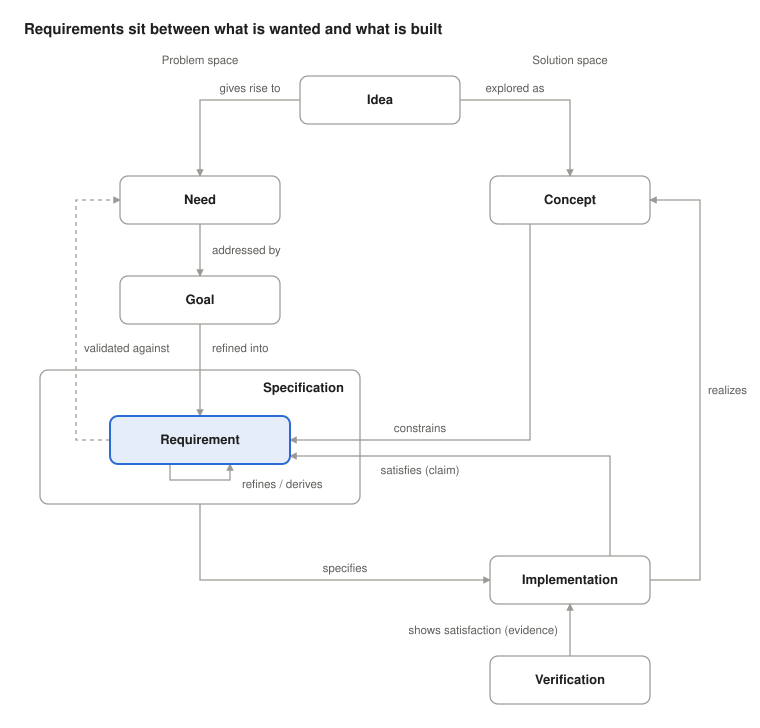
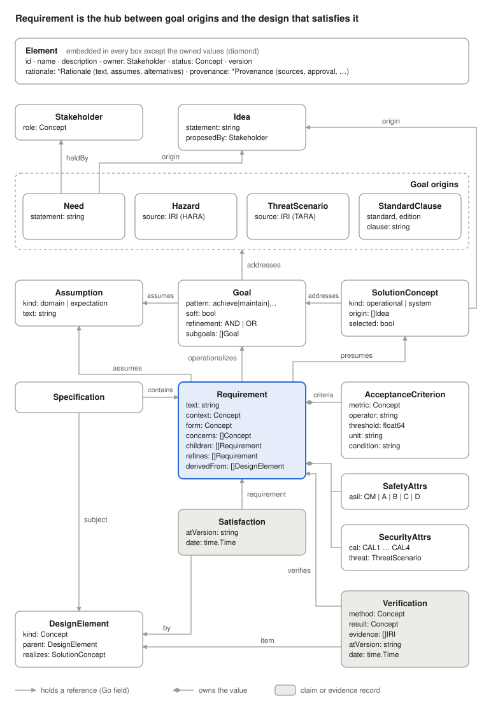

# Requirements Vocabulary: Semantics and Relationships

Nov 13, 2026 · @Jan

These words sit on two different axes, and much of the confusion around them comes from mixing the axes up. One axis runs from vague to precise, which is the thing that matters when refining. The other runs from the problem ("what is wanted") to the solution ("what is built"). A third complication is that the three "-tion" words each have several readings.

## The terms

**Idea.** A notion one person holds that something could be done or would be good. It's informal and unvalidated. It may mix what's wanted with how to get it ("a Doodle that puts holds in calendars" is both). It's the seed that everything later should trace back to. Typical modifiers: *initial idea*, *raw idea*, *product idea*.

**Goal.** An objective the system should achieve, at any level of abstraction, from "meetings get scheduled without email ping-pong" down to "each participant sees a hold in their calendar." Goals are refined into subgoals through AND/OR trees (AND: all subgoals needed; OR: alternative ways to reach it). A goal that one component can be made responsible for becomes a requirement. A goal is broader than a need: a need is one stakeholder's problem, while a goal is what the system commits to. Typical modifiers: *high-level goal*, *subgoal*, *achieve goal* / *maintain goal* / *cease goal* / *avoid goal* (the pattern: what must hold, and when), *soft goal* (no clear-cut satisfaction, such as "usable"). Pattern and softness are independent: a soft goal can still be an achieve or a maintain goal.

**Need.** The stakeholder's problem or desired outcome, stated in their own terms and free of any solution. It sits between idea and requirement: an idea gives rise to needs, goals address needs, and goals are refined into requirements. It's what validation checks against. Typical modifiers: *stakeholder need*, *user need*, *business need*.

**Concept.** This word has two meanings, and a model needs to pick one:

1. *Terminological concept*: a unit of meaning, like `skos:Concept` ("tentative hold," "participant"). These are the vocabulary requirements are written in.
2. *Solution concept*: an approach chosen from among alternatives, described well enough to reason about. Systems engineering uses this sense in *concept of operations*, *operational concept* and *system concept*.

In requirements work, sense 2 usually sits between the idea and the requirements. You explore a few concepts, pick one, and the choice limits what the requirements can say. The data model below uses sense 2 and calls it *SolutionConcept*, so it can't be confused with `skos:Concept`, which the model uses for sense 1.

**Requirement.** A statement of something a solution must do or be, or a limit it must stay within. ISO/IEC/IEEE 29148 asks that each requirement be necessary, unambiguous, verifiable, feasible and free of implementation detail ("what," not "how"). Common modifiers:

- By origin: *stakeholder*, *system*, *derived*, *allocated*
- By kind: *functional*, *quality* (non-functional), *constraint*, *interface*
- By lifecycle status, which is recorded: *proposed*, *approved*, *rejected*, *obsolete*
- By evidence, which is computed from satisfaction and verification records: *satisfied*, *verified*
- By context, which must always be stated: *tool* (an AI-assisted engineering tool itself), *product* (vehicle or cloud software built with such tools), *training data* (data used to train or fine-tune an ML model)

**Acceptance criterion.** The measurable condition that decides whether a requirement is met, such as "95% of holds appear within 60 s." Also called a *fit criterion*. Adding one is the concrete step of refining for precision. A requirement with no acceptance criterion can't be verified.

**Assumption.** Something about the environment that the solution relies on but doesn't control or build, such as "participants' calendar servers accept tentative events." Also called a *domain property* when it's a fact about the world and an *expectation* when it's about people's behavior. A specification satisfies a requirement only together with its assumptions. If an assumption turns out to be false, every requirement that depends on it has to be revisited.

**Specification.** Something precise enough that someone else can build to it and check against it. Usually it's a container: a requirements specification groups requirements for one item. But there are also *design specifications*, *interface specifications* and *test specifications*. In formal methods, "specification" means a mathematical description of allowed behavior. In practice, a specification is a requirement's precise description, or a collection of such descriptions.

**Design.** The chosen "how" for one level: the structure, components and decisions that are meant to satisfy the requirements. It sits between specification and implementation. Every design decision is a requirement for the level below it. Typical modifiers: *architectural design*, *detailed design*, *design decision*, *design alternative*.

**Rationale.** Why a goal, requirement or design decision exists or was chosen over the alternatives. It links an element to the reasoning behind it, and often to the assumptions it depends on. When something changes, rationale shows what else becomes questionable. Typical modifiers: *design rationale*, *decision rationale*.

**Realization.** The relation in which something concrete embodies something abstract. UML uses it for a dependency between a specification and whatever fulfills it. This model uses it more narrowly: a design element *realizes* the solution concept it embodies. That an implementation meets a specification is already said, more precisely, by its satisfaction claims on the specification's requirements, so the model doesn't repeat it as a realization. It can also mean the act of realizing, or the result (a physical realization).

**Implementation.** The concrete artifact (code, hardware, a deployed service), or the act of building it. Common modifiers: *reference implementation*, *partial implementation*, *prototype implementation*.

## How they relate

Requirements are the hub: ideas reach them through needs and goals, a chosen concept constrains them, specifications group them, and implementations claim to satisfy them. An idea can also be explored directly as a concept, since ideas often carry a "how"; the implementation then realizes the concept, and a specification states what that implementation has to meet.



Three points matter for tracking how requirements are met.

**It's recursive.** A design choice at one level ("use calendar holds via CalDAV") becomes a requirement at the next level down. So "requirement" vs. "design" depends on where you stand, not on the statement itself. Suh's Axiomatic Design describes this as zigzagging between functional requirements and design parameters. The V-model is the same idea drawn as a process. Refinement works this way: you refine by choosing a concept, and the choice produces new, more detailed requirements.

**Satisfy, verify and validate are three different things.** *Satisfies* is a claim that this implementation meets this requirement. *Verified by* is the evidence for that claim (a test, an analysis, an inspection). *Validation* asks whether the requirement was the right one, by tracing it back to the need or idea. Tracking satisfaction needs all three, and claims must stay separate from evidence.

**The "-tion" words are ambiguous.** Specification, realization and implementation each have an act reading, an artifact reading and (for realization) a relation reading. In an ontology, make *Implementation* and *Specification* classes (artifacts), make *realizes* an object property (here from a design element to the solution concept it embodies), and model the activities as separate processes if needed.

## Existing vocabularies

Existing vocabularies already define most of these relations. SysML has `deriveReqt`, `refine`, `satisfy`, `verify` and `trace`. OSLC Requirements Management has `elaboratedBy`, `decomposedBy`, `satisfiedBy`, `implementedBy` and `validatedBy`. Aligning with one is probably better than inventing new terms.

## Refinement: both senses

Refinement means both more precision and splitting into parts, so the model needs separate relations for each, plus one for requirements that come from design choices.

| Relation | What changes | Example | Check |
| --- | --- | --- | --- |
| refines | Precision, same scope | "Responds quickly" → "Responds within 200 ms at p95" | The refined statement implies the original |
| decomposes | Scope, split into parts | "Schedule a meeting" → "collect availability" + "place holds" + "confirm slot" | The parts together imply the parent (completeness) |
| derives | Origin, follows from a design choice | "Use CalDAV" → "Write tentative events via CalDAV" | Traces to the design decision that caused it, and through it to the requirement that decision satisfies |

The completeness check for decomposition, and for AND-refinement of goals, usually holds only under domain assumptions. Jackson and Zave put it as: specification plus domain properties entail the requirement. Those assumptions must be recorded, or the check can't be made.

## Why export to RDF and SysML v2

The two exports serve different readers. RDF lets software reason over and query the requirements together with other knowledge. SysML v2 lets engineers see and work with the system of systems.

|  | RDF (Turtle) | SysML v2 |
| --- | --- | --- |
| Main reader | Queries, reasoners, other tools | Systems engineers |
| Strength | Linking requirements to other graphs: vehicle signals (COVESA VSS), service descriptions (Arrowhead, mbaigo), standard clauses | Structure and behavior of the system of systems, in diagrams and textual views |
| Checks | SPARQL queries and SHACL shapes, such as "every safety goal has an ASIL" or "every requirement is verified" | Model consistency checked by SysML v2 tools; constraints evaluated in analyses |
| Inference | RDFS and OWL: class hierarchies, inverse relations, transitive refinement | Specialization and redefinition of definitions |
| Typical question | Which requirements depend on an assumption that turned out to be false? | Which part satisfies this requirement, and how does it connect to the others? |

Two caveats:

- OWL reasoning assumes an open world: a missing verification is unknown, not absent. Completeness checks therefore need SHACL or SPARQL, which treat the data as closed.
- SysML v2 is more than a visualization: it's the medium engineers work in. If they edit the `.sysml` model, those changes must flow back to Go, or the export becomes a fork. See the open question below.

### Open question: is `.sysml` export-only?

The answer decides where the source of truth lives and whether we need a SysML v2 parser in Go.

| Option | What engineers do | Gains | Costs |
| --- | --- | --- | --- |
| Export-only | Read and analyze the `.sysml`; changes go through the Go model | One source of truth; no parser | Their edits are lost on the next export, so they may keep a parallel model anyway |
| Round-trip | Edit anything in `.sysml`; changes are imported back into Go | Engineers work where they already are | A Go parser for the SysML v2 textual notation; merge conflicts; constructs the Go model lacks must be kept or dropped |
| Split ownership | Own the design (parts, interfaces, `satisfy`) in SysML; Go owns goals, requirements and verification | Each side edits what it knows; the import is small (design element IDs and `satisfy` links) | Two sources of truth; the seam needs checks, such as a `satisfy` pointing to a missing requirement |

What would settle it:

- Who edits what: do engineers change requirements, or only the design that satisfies them?
- How often the two sides change, and whether edits happen at the same time.
- Whether exchange goes through files or through the standard Systems Modeling API, which makes partial import easier.

A low-risk start is export-only, with the model kept ready for split ownership: stable IDs used as SysML short names, and design elements and `satisfy` links kept separable from the rest.

**Decision (Nov 13, 2026):** export-only for now. No SysML v2 parser is needed. The model stays ready for split ownership as described above, so the question can be reopened.

## Data model

Requirement is the central struct for the SDV model: other structs either feed it, are owned by it, or link to it through a struct of their own. Go is the source of truth; `.ttl` and `.sysml` are generated from it.



Arrows point the way the Go field points: a Goal holds the IDs of what it addresses, and a Satisfaction holds the IDs of both the Requirement and the DesignElement. Besides a Need, `Goal.addresses` can point to a hazard (from a HARA), a threat scenario (from a TARA) or a clause of a standard or regulation, so Need is one origin of goals among several.

### Mapping to Turtle and SysML v2

`req:` is our own namespace, with `req:Requirement rdfs:subClassOf oslc_rm:Requirement` and `req:refines` transitive. Element IRIs are a chosen base plus the ID; concept IRIs are the base plus `scheme/<scheme>/<concept>`, each a `skos:Concept` in a `skos:ConceptScheme`.

In SysML v2, standard constructs carry what the language has words for: `requirement`, `concern`, `satisfy`, `verification`, `#refinement` and `#derivation`. The model's other relations become dependencies tagged with metadata defined in a generated `Vocabulary` package (`#subgoal dependency 'G-001' to 'G-002';`), and concept schemes become enum defs. Every element keeps its ID as its short name.

| Go struct | Key fields | Turtle (.ttl) | SysML v2 (.sysml) |
| --- | --- | --- | --- |
| Element | ID, Name, Description | IRI from ID, `dcterms:identifier`, `rdfs:label`, `dcterms:description` | short name `<'REQ-042'>`, declared name, `doc` or `comment` |
| Element | Owner, Status, Version | `req:owner`, `req:status`, `req:version` | `#owner` dependency; `@Lifecycle { status; version; }` |
| Rationale | Text, Assumes, Alternatives | blank node under `req:rationale` with `req:text`, `req:assumes`, `req:alternative` | `@Rationale { text; }` (ModelingMetadata); `#assumes` and `#alternative` dependencies |
| Provenance | Sources, GeneratedBy, ApprovedBy, ApprovedOn, ExternalTool, ExternalID | `prov:wasDerivedFrom` the sources that are IRIs (`req:sourceNote` for the rest), `prov:wasGeneratedBy` an activity `prov:wasAssociatedWith` the model, `prov:wasAttributedTo` the approver; `req:approvedOn`, `req:externalTool`, `req:externalID` | `@ProvenanceInfo`; `#approvedBy` dependency |
| Stakeholder | Role | `req:Stakeholder`, `req:role` | `#Stakeholder part def` with `@RoleInfo` |
| Idea | Statement, ProposedBy | `req:Idea`, `req:statement`, `req:proposedBy` | `comment`; `#proposedBy` dependency |
| Need | Statement, HeldBy, Origin | `req:Need`, `req:statement`, `req:heldBy`, `req:origin` | `concern` with `doc` and `stakeholder` members; `#origin` dependency to the idea |
| Goal | Pattern, Soft, Refinement, Subgoals, Addresses | `req:Goal`, `req:pattern`, `req:soft`, `req:refinement`, `req:subgoal`, `req:addresses` | `#Goal requirement` with `@GoalInfo`; `#subgoal` and `#addresses` dependencies |
| SolutionConcept | Kind, Addresses, Origin, Selected | `req:SolutionConcept` (not `skos:Concept`), `req:kind`, `req:conceptFor` (not `req:addresses`, which is only for goals), `req:origin`, `req:selected` | `#SolutionConcept part def` with `@ConceptInfo { kind; selected; }`; `#conceptFor` dependency to the goals, `#origin` dependency to the ideas |
| Requirement | Text, Context, Form, Concerns | `req:text`, `req:context`, `req:form`, `req:concern` (SKOS concepts) | `requirement` with `doc` and `@Classification` |
| Requirement | Operationalizes, Children, Concept | `req:operationalizes`, `req:child`, `req:presumes` | `#operationalizes`, `#child` and `#presumes` dependencies |
| Requirement | Refines | `req:refines` | `#refinement` dependency (ModelingMetadata) |
| Requirement | DerivedFrom | `req:derivedFrom` (to the DesignElement) | `#derivation` connection (RequirementDerivation) from each requirement the DesignElement satisfies to this one |
| Goal, Requirement | Assumes | `req:assumes` | `assume constraint` typed by the Assumption's `constraint def` |
| AcceptanceCriterion | Metric, Operator, Threshold, Unit, Condition | blank node under `req:criterion`, threshold as `xsd:decimal` | an `attribute` per metric and `require constraint { 'metric' <= threshold }`, unit and condition in `@CriterionInfo` |
| Assumption | Kind, Text | `req:Assumption`, `req:kind`, `req:text` | `constraint def` with `doc` and `@AssumptionInfo` |
| SafetyAttrs / SecurityAttrs | ASIL, CAL, ThreatScenario | `req:asil`, `req:cal`, `req:threatScenario` | `@SafetyInfo`, `@SecurityInfo`; `#threatScenario` dependency |
| Hazard, ThreatScenario, StandardClause | Source; Standard, Edition, Clause | `req:source`; `req:standard`, `req:edition`, `req:clause` | `#Hazard`, `#ThreatScenario`, `#StandardClause item def` with `@SourceInfo` or `@ClauseInfo` |
| Specification | Contains, Subject | `req:Specification`, `req:contains`, `req:subject` | `#Specification requirement def`; `#contains` and `#specSubject` dependencies |
| DesignElement | Kind, Parent, Realizes | `req:DesignElement`, `req:kind`, `req:parent`, `req:realizes` | `part` usages nested by Parent, with `@DesignInfo`; `#realization` dependency |
| Satisfaction | Requirement, By, Owner (claimant), AtVersion, Date | `req:Satisfaction` node, plus a direct `oslc_rm:satisfiedBy` triple for active claims | `satisfy 'REQ' by 'DE-1'::'DE-2' { @ClaimInfo }`; rejected and obsolete claims are left out |
| Verification | Verifies, Item, Method, Result, Evidence, AtVersion, Date | `req:Verification`, `req:verifies`, `req:item`, `req:method`, `req:result`, `req:evidence` | `verification` with `objective { verify 'REQ'; }` and `@VerificationInfo` (verdict from the model's scheme); `#verifiedItem` dependency |

The SysML output is checked by the tests for balanced structure and resolvable names, not yet by a SysML v2 parser; run it through the SysML v2 Pilot Implementation or another conforming tool before relying on it.

### Ontology and shapes

The `req:` vocabulary is an OWL 2 RL ontology (`req export ontology`), so rule engines such as GraphDB's owl2-rl rulesets can reason with it. Each part of the work is done by the tool suited to it:

| Question | Done by | Why |
| --- | --- | --- |
| What does this trace to, what serves this hazard? | The ontology: inverses, transitive `req:tracesTo` (any path) and `req:contributesTo` (goal path), and the chain `contributesTo ∘ addresses ⊑ servesOrigin` | Open-world inference adds links; it never needs to know that something is missing |
| Is the data well formed? | SHACL structural shapes (`req export shapes`), installed in the store | Closed-world rules; the store rejects a bad write |
| What is incomplete? | SHACL gap shapes (`req export gaps`), run on demand | Warnings, not errors; installed, they would block every write |
| Is it satisfied, verified, covered? | The Go model, exported as `req:isSatisfied`, `req:isVerified`, `req:isCovered` | Depends on dates, versions and "latest"; kept in deterministic code |

`req:servesOrigin` matches the model's coverage relation, and `req:tracesTo` its trace, so graph queries and the tool give the same answers. Both were checked in GraphDB against the example.

Links between elements have no `rdfs:domain` or `rdfs:range`. A reasoner turns a link to the wrong kind of element into a false type: with a range of Goal on `operationalizes`, a requirement that wrongly operationalizes another requirement is inferred to be a goal, and the SHACL class check, which sees inferred types, then passes. The intended kinds are documented with `schema:domainIncludes` and `schema:rangeIncludes`, which carry no inference, and enforced by the shapes. Properties whose values are sometimes IRIs and sometimes text (`req:evidence`, `req:source`) are annotation properties, as OWL requires.

### Go sketch

```go
package req

import "time"

type Ref string // ID of another element

// Element is embedded in every model element.
type Element struct {
	ID          string // stable, matches [A-Za-z][A-Za-z0-9-]*, e.g. "REQ-042"
	Name        string
	Description string
	Owner       Ref // Stakeholder
	Status      Ref // lifecycle SKOS concept: proposed, approved, rejected, obsolete
	Version     string
	Rationale   *Rationale  // nil when none is recorded
	Provenance  *Provenance // nil when written directly in this model
}

// Provenance records where content came from and who accepted it.
type Provenance struct {
	Sources      []string // URIs of documents the content was taken from
	GeneratedBy  string   // model and version when AI-generated; empty when written by a person
	ApprovedBy   Ref      // Stakeholder who accepted the content
	ApprovedOn   time.Time
	ExternalTool string // tool it was imported from: reqif, sphinx-needs, ...
	ExternalID   string // its ID in that tool, kept for re-import
}

// Rationale links an element to the reasoning behind it.
type Rationale struct {
	Text         string
	Assumes      []Ref // Assumption the reasoning depends on
	Alternatives []Ref // elements considered and not chosen
}

type Stakeholder struct {
	Element
	Role Ref // SKOS concept: driver, OEM, supplier, regulator, ...
}

type Idea struct {
	Element
	Statement  string
	ProposedBy Ref // Stakeholder
}

type Need struct {
	Element
	Statement string
	HeldBy    []Ref // Stakeholder
	Origin    []Ref // Idea
}

type Goal struct {
	Element
	Pattern    Ref    // achieve, maintain, cease, avoid
	Soft       bool   // no clear-cut satisfaction, e.g. "usable"
	Refinement string // "AND" or "OR"
	Subgoals   []Ref
	Addresses  []Ref // Need, Hazard, ThreatScenario or StandardClause
	Assumes    []Ref // Assumption needed for the subgoals to imply the goal
}

// SolutionConcept is sense 2 of "concept". Sense 1 is skos:Concept.
type SolutionConcept struct {
	Element
	Kind      Ref   // operational, system
	Addresses []Ref // Goal
	Origin    []Ref // Idea the concept was explored from
	Selected  bool  // alternatives stay in the model with Selected false
}

type Requirement struct {
	Element
	Text            string
	Context         Ref   // what the requirement is on: tool, product or training-data
	Form            Ref   // functional, quality, constraint, interface
	Concerns        []Ref // safety, security, privacy, performance, ...
	Operationalizes []Ref // Goal
	Concept         Ref   // SolutionConcept the requirement presumes; empty if none
	Children        []Ref // decomposition
	Refines         []Ref
	DerivedFrom     []Ref // DesignElement whose choice caused this requirement
	Assumes         []Ref // Assumption
	Criteria        []AcceptanceCriterion
	Safety          *SafetyAttrs   // nil unless a safety concern
	Security        *SecurityAttrs // nil unless a security concern
}

type AcceptanceCriterion struct {
	Metric    Ref    // SKOS concept, e.g. hold-latency-p95
	Operator  string // "<", "<=", "=", ">=", ">"
	Threshold float64
	Unit      string // ISO 80000 symbol, e.g. "s"
	Condition string // context in which it applies; optional
}

type Assumption struct {
	Element
	Kind Ref // domain property or expectation
	Text string
}

type SafetyAttrs struct {
	ASIL Ref // QM, A, B, C, D
}

type SecurityAttrs struct {
	CAL            Ref // CAL1 to CAL4
	ThreatScenario Ref
}

type Hazard struct {
	Element
	Source string // IRI into the HARA results
}

type ThreatScenario struct {
	Element
	Source string // IRI into the TARA results
}

type StandardClause struct {
	Element
	Standard string // e.g. "ISO 26262-3"
	Edition  string // e.g. "2018"
	Clause   string // e.g. "7"
}

type Specification struct {
	Element
	Subject  Ref   // DesignElement the specification is for
	Contains []Ref // Requirement
}

type DesignElement struct {
	Element
	Kind     Ref // system, subsystem, component, interface, ml-model, dataset, ...
	Parent   Ref
	Realizes Ref // SolutionConcept; empty if none
}

// Satisfaction is a claim. Element.Owner is the claimant.
type Satisfaction struct {
	Element
	Requirement Ref
	By          Ref    // DesignElement
	AtVersion   string // version of By
	Date        time.Time
}

// Verification is evidence for a claim. Element.Owner is who performed it.
type Verification struct {
	Element
	Verifies  []Ref    // Requirement
	Item      Ref      // DesignElement under verification
	Method    Ref      // test (narrower: sil-test, hil-test, vil-test, shadow-test), analysis, inspection, demonstration
	Result    Ref      // pass, fail, inconclusive, error (SysML VerdictKind)
	Evidence  []string // URIs of reports, logs, test runs
	AtVersion string   // version of Item
	Date      time.Time
}
```

### Design choices

- References are IDs (`Ref`), not pointers. The structs stay acyclic, and each export is a lookup.
- IDs match `[A-Za-z][A-Za-z0-9-]*` and never change. They are IRI-safe as they stand, and they become quoted SysML short names (`<'REQ-042'>`), which allow the hyphen.
- Form, concerns, status and ASIL values are SKOS concepts in the `.ttl`, and enumeration defs in the `.sysml`. The taxonomy grows without code changes.
- `Status` holds only the lifecycle (proposed, approved, rejected, obsolete). Whether a requirement is satisfied or verified is computed from Satisfaction and Verification records, so a stored status can't contradict the evidence.
- Satisfaction and Verification are structs because they carry who, when and which version. They embed Element, so a claim can carry its own status and rationale. The direct `oslc_rm:satisfiedBy` triple keeps simple queries simple.
- Rationale is structured, not free text, so that "which decisions depend on an assumption that turned out to be false?" is a query.
- Need and Goal both stay. A Need is what a stakeholder asked for; a Goal is what the system commits to. Requirements trace to Needs only through Goals (Idea → Need → Goal → Requirement), so there is one path to query.
- A concept in the model is a SolutionConcept. Rejected alternatives stay in the model with `Selected` false, and the chosen one's Rationale lists them.
- Goal pattern and softness are separate fields, because they vary independently.
- Assumptions attach to Goals as well as Requirements, because AND-refinement of a goal has the same completeness check as decomposition of a requirement.
- `DerivedFrom` points to the DesignElement, which is the cause. SysML's derivation links requirements to requirements, so the export connects the requirements that the DesignElement satisfies to the derived one. If the DesignElement satisfies nothing, the derivation can't be exported, and the exporter reports it as an error.
- Every requirement states its context: tool, product or training-data. A requirement's children and refinements must share its context, and the completeness checks report any that don't. Derivation may cross contexts: choosing an ML model for a product function is what gives rise to requirements on its training data.
- AI-generated content records the model and version that produced it, and it counts as approved only with a named approver. This supports the human oversight that the EU AI Act requires of high-risk AI systems (Article 14); for an engineering tool that isn't high-risk, it's good practice rather than an obligation. The provenance maps to W3C PROV.
- Requirements from other tools are imported, not retyped: ReqIF covers DOORS, Polarion, Codebeamer and Jama, and Sphinx-Needs exports `needs.json`. An imported element keeps its tool and external ID, so a re-import updates it. If the text changed in the tool, the status goes back to proposed and the approval is cleared. Only text, name, grouping and refinement are imported. The partner tool stays the source of the wording; this model owns the trace links, where they can be checked.
- Verdicts are computed, never judged by a language model: satisfied, verified, covered and the completeness gaps all follow from the records. That keeps the tool-qualification argument (ISO 26262-8 tool confidence level) about deterministic code, with the LLM limited to proposing changes that a person accepts.
- Impact works on any element. For a clause revised in a new edition, it lists the goals and requirements to review. The release gate (`req gate`) fails on structural errors or unverified requirements, so CI can enforce release readiness.

## Standards and where they enter

Standards enter the model in two ways: some shape the method and the export formats, and others impose content on SDV requirements. The second kind enters through `Goal.addresses` and the safety and security attributes.

**Method and formats**

| Standard | What it governs | Where in the model |
| --- | --- | --- |
| ISO/IEC/IEEE 29148 | Requirements engineering; qualities of a well-formed requirement | Requirement definition; acceptance criteria make it verifiable |
| ISO/IEC/IEEE 15288 | System life-cycle processes, including verification and validation | Satisfaction, Verification |
| ISO/IEC 25010 | Product quality model (performance efficiency, reliability, security, …) | Concept scheme for quality forms and concerns |
| OMG SysML v2 | Modeling language and textual notation | `.sysml` export |
| W3C RDF and SKOS; OASIS OSLC RM | Graph format, concept schemes, requirement link vocabulary | `.ttl` export; form, concern and status schemes |
| W3C PROV | Provenance of data and artifacts | `Element.Provenance` in the `.ttl` export |
| OMG ReqIF 1.2 | Requirements exchange between tools | Import from DOORS, Polarion, Codebeamer, Jama |
| Automotive SPICE 4.0, including machine learning engineering (MLE) and ML data management (SUP.11) | Process capability, including bidirectional traceability and consistency between levels | The trace graph; validation and completeness checks as consistency evidence |
| ISO 26262-8 | Confidence in software tools (tool confidence level) | Verdicts computed deterministically, never by the LLM |

**SDV content**

| Standard | What it imposes | Where in the model |
| --- | --- | --- |
| ISO 26262 | Functional safety: hazard analysis (HARA), safety goals, ASIL | Hazard → Goal (safety goal) → Requirement; `SafetyAttrs.asil` |
| ISO 21448 (SOTIF) | Hazards without faults, such as sensor limits | Hazard as a Goal origin; Assumption for the operational design domain |
| ISO/SAE 21434 | Cybersecurity engineering: threat analysis (TARA), cybersecurity goals, CAL | ThreatScenario → Goal; `SecurityAttrs.cal` |
| UNECE R155 | Cybersecurity management system, required for type approval | StandardClause → Goal; Verification as audit evidence |
| UNECE R156, ISO 24089 | Software update management and engineering | StandardClause → Goal; constraints on over-the-air updates |
| ISO/PAS 8800 | Safety of AI in road vehicles, including the data sets | ML models and data sets as DesignElements; training-data requirements |
| ISO/PAS 5112 | Auditing cybersecurity management systems | StandardClause → Goal; Verification as audit evidence |
| EU AI Act (Regulation (EU) 2024/1689) | For high-risk AI systems, such as AI safety components in vehicles: risk management, data governance, human oversight and post-market monitoring | StandardClause → Goal; provenance and approval of AI-generated content |

What this needs from the model:

- **StandardClause** as a referenceable element: standard, edition and clause, such as ISO 26262-3:2018 clause 7. The edition matters because standards are revised. The model references clauses and doesn't copy their text.
- **Hazard** and **ThreatScenario** as small classes, or as IRIs into the HARA and TARA results, since safety and cybersecurity goals originate there.
- A compliance check then becomes a query: every clause addressed by a Goal, and every Requirement under it satisfied and verified.
- **ML models and data sets** as DesignElement kinds, so requirements on them (ISO/PAS 8800) are satisfied and verified like any other. An over-the-air ML model update is then an ordinary change with a safety goal above it.
- **Verification methods** narrow enough for SDV testing: software-, hardware- and vehicle-in-the-loop tests, and silent-mode (shadow) tests in the vehicle next to the live version.
- Coverage of the operational design domain (did silent-mode testing see every weather condition of interest?) is free text in `AcceptanceCriterion.Condition` today. It may need its own structure.
